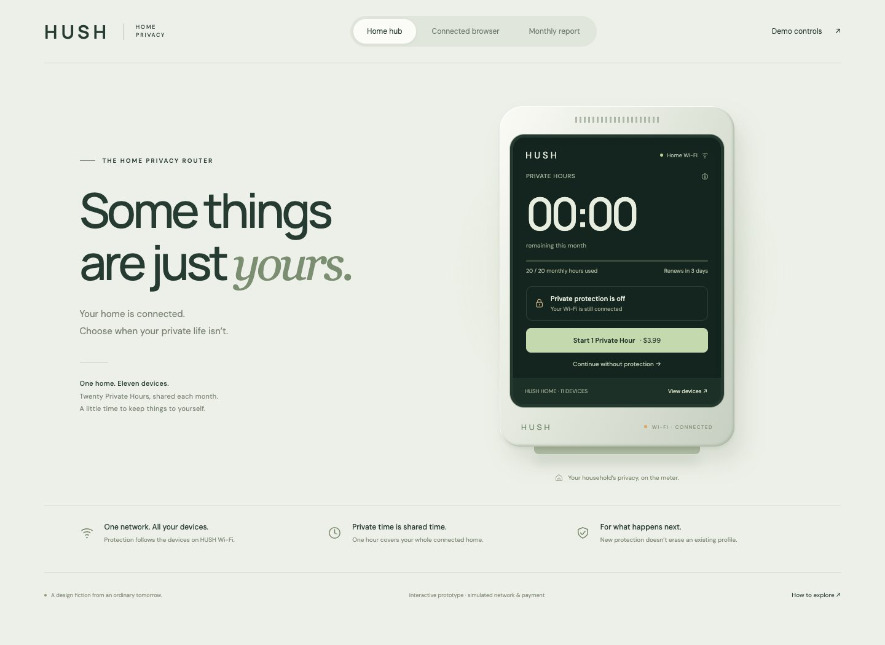
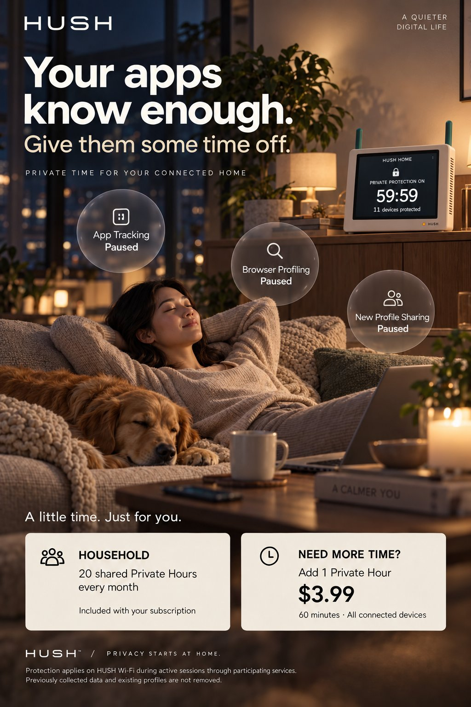

# HUSH — Home Privacy Utility

IDEA9201 Assessment 4 · Design fiction collaboration workspace

**给组员和 AI：先读 [START_HERE.md](START_HERE.md)，再读 [当前进度](STATUS.md)。**

> What if privacy was no longer a right, but a subscription?

HUSH 是一台带屏幕的家庭 Wi-Fi 隐私路由器。在这个虚构未来，家庭每月共享有限的 Private Hours。人们开始衡量哪些私人活动值得消耗一小时的保护。

## 当前概况

| 项目 | 当前状态 |
|---|---|
| 核心体验 | 20 小时/月；当前已用完；3 天后更新；额外一小时 $3.99；11 台设备 |
| 产品形态 | 带屏 Wi-Fi 路由器，保护范围取决于网络连接和保护时段 |
| 点击原型 | 已实现并检查；[源码](prototype/)；模拟支付和网络保护 |
| 实体制作 | 已购买白色相框和六色黏土，计划套在横放 iPad 外；未收到完成照 |
| 最新广告 | [暖色夜景生活方式海报](assets/advertisements/04-lifestyle.jpg)，待组内审核 |
| 最大待定项 | 未付费的具体生活后果和最终演示故事 |
| 交付缺口 | 说明书、最终实体照片、最终 slides、整理后的提交 PDF |

## 项目入口

- [当前状态与待办](STATUS.md)
- [已定设定及待确认规则](docs/WORLD_RULES.md)
- [老师反馈与作业要求](docs/BRIEF_AND_FEEDBACK.md)
- [历史与取舍](docs/HISTORY.md)
- [人物情节探索](docs/NARRATIVE.md)
- [实体制作](docs/PHYSICAL.md)
- [广告与视觉](docs/ADVERTISEMENT.md)
- [素材目录和出处](assets/INDEX.md)
- [AI 使用记录](ai/USAGE.md)
- [协作流程](CONTRIBUTING.md) · [AI 工作约定](AGENTS.md) · [进度日志](WORK_LOG.md)

## 原型预览

[打开原型](https://hush-private-hours-home.pastelray9.chatgpt.site)（先前部署为 owner-private，不保证其他组员可直接访问；以仓库源码为协作依据）。

无需安装，下载仓库后在浏览器打开 `prototype/index.html`。部署链接不会随着 GitHub 更新自动发布；需要独立同步和部署。

## 最新广告方向

此图为 AI 生成的未来正式产品广告，不是实体相框制作照片。海报未被用户最终确认。所有图像的状态和历史见素材目录。

## 范围与来源

这份仓库整理自 2026-11-02 的项目对话、用户提供的作业材料和生成产物，是编辑后的项目交接，不是逐字聊天记录。课程 PDF 原件、私人照片和本地绝对路径不随公开仓库上传。图像仅为协作预览的 JPEG 版本；原 PNG 在原协作者处保留。未添加开源许可证；访问公开仓库不等于另行授权所有素材用途。
