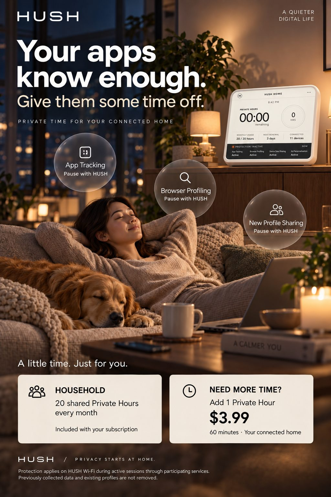
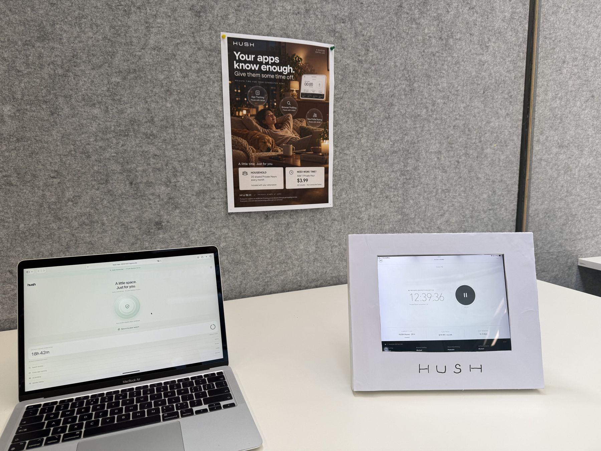
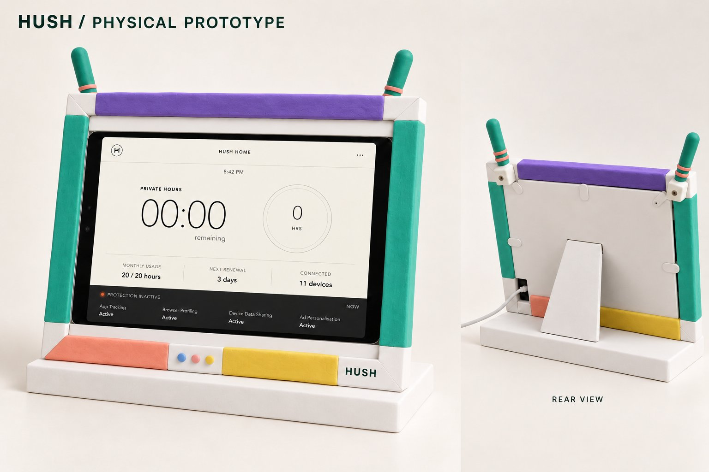

# HUSH — Home Privacy Utility

IDEA9201 Assessment 4 · Design fiction collaboration workspace

**给组员和 AI：先读 [START_HERE.md](START_HERE.md)，再读 [当前进度](STATUS.md)。**

> What if privacy was no longer a right, but a subscription?

HUSH 是一台带屏幕的家庭 Wi-Fi 隐私路由器。在这个虚构未来，家庭每月共享有限的 Private Hours。人们开始衡量哪些私人活动值得消耗一小时的保护。

## 当前概况

| 项目 | 当前状态 |
|---|---|
| 核心体验 | 20 小时/月；当前已用完；3 天后更新；额外一小时 $3.99；11 台设备 |
| 产品形态 | 带屏 Wi-Fi 路由器，保护范围取决于网络连接和保护时段 |
| 最终点击原型 | [用户指定的 Figma 最终版](https://banner-dish-90173388.figma.site)；此前绿色版本已弃用 |
| 实体制作 | 用户已提供实体完成照片；白色外框、iPad 屏幕和展示现场已记录 |
| 最新广告 | [白色无天线生活方式海报](assets/advertisements/05-white-no-antennas.jpg)，待组内审核 |
| 总提交 PDF | [粗糙初稿，随手先拼的](submission/HUSH_A4_Submission_DRAFT.pdf)，未经组内审核；改之前先读 [submission/README.md](submission/README.md) |
| 说明书 | [8 页 A5 Quick Start Guide](instructions/HUSH_Quick_Start_Guide.pdf)，草稿待组内审核；改之前先读 [instructions/README.md](instructions/README.md) |
| 最大待定项 | 未付费的具体生活后果和最终演示故事 |
| 交付缺口 | 整理后的提交 PDF（slides 交 W11 原版）；说明书草稿和实体照片已提供 |

## 项目入口

- [当前状态与待办](STATUS.md)
- [已定设定及待确认规则](docs/WORLD_RULES.md)
- [老师反馈与作业要求](docs/BRIEF_AND_FEEDBACK.md)
- [历史与取舍](docs/HISTORY.md)
- [人物情节探索](docs/NARRATIVE.md)
- [实体制作](docs/PHYSICAL.md)
- [广告与视觉](docs/ADVERTISEMENT.md)
- [说明书（工程文件和修改方法）](instructions/README.md)
- [素材目录和出处](assets/INDEX.md)
- [AI 使用记录](ai/USAGE.md)
- [协作流程](CONTRIBUTING.md) · [AI 工作约定](AGENTS.md) · [进度日志](WORK_LOG.md)

## 原型预览

- **[HUSH 页面](https://banner-dish-90173388.figma.site)**：家庭设备界面。
- **[手机模拟](https://feed-test-35321007.figma.site)**：用户提供的手机模拟页面。

**[打开用户指定的最终版原型](https://banner-dish-90173388.figma.site)**。已检查首页；完整交互与可编辑源码尚未核实。仓库 `prototype/` 和 `assets/prototype/` 为先前被用户否决的历史版本，不得作为最终作品。

## 最新广告方向

此图为 AI 生成的未来正式产品广告，不是实体相框制作照片。海报未被用户最终确认。

## 实体 prototype 完成照片

[查看实体作品正面照](assets/physical/06-actual-front.jpg) · [查看现场整体照片](assets/physical/05-actual-exhibition.jpg)

以上是用户提供的实体成品照片。实物采用白色外框和 iPad 屏幕；现场也展示了打印广告与电脑页面。

## 早期实体 prototype 示意图

[查看相框与彩色黏土实体 prototype 示意图](assets/physical/04-colourful-frame.jpg)。该图为早期 AI 制作的方向参考，展示相框、iPad、内衬和材料配色，不代表最终成品；与上方未来产品广告采用不同外观。其他版本见[素材目录](assets/INDEX.md)。

## 范围与来源

这份仓库整理自 2026-11-02 的项目对话、用户提供的作业材料和生成产物，是编辑后的项目交接，不是逐字聊天记录。课程 PDF 原件、聊天原文和本地绝对路径不随公开仓库上传。用户提供的实体作品照片以去除元数据的 JPEG 预览形式共享；生成图像的原 PNG 和用户提供的 HEIC 原件由原协作者保留。未添加开源许可证；访问公开仓库不等于另行授权所有素材用途。
